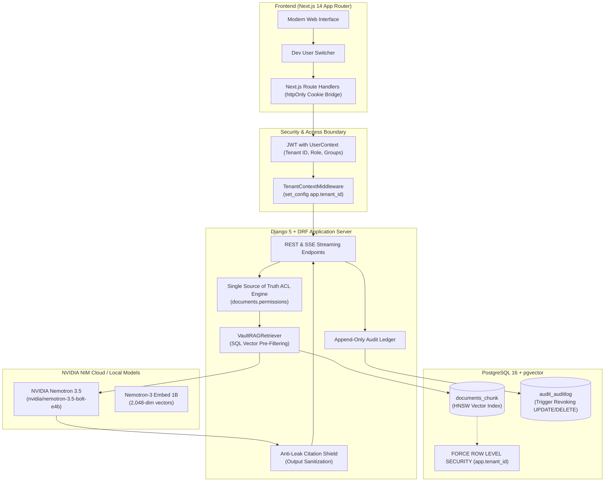

# VaultRAG — Permission-Aware Multi-Tenant RAG Service

[](https://github.com/LuckyM09/Permission-Aware-Multi-Tenant-RAG-Service/actions)
[](LICENSE)
[](https://python.org)
[](https://djangoproject.com)
[](https://nextjs.org)
[](https://github.com/pgvector/pgvector)
[](https://developer.nvidia.com)

> **Enterprise-grade Retrieval-Augmented Generation (RAG) service engineered with Access Control by Design.** Features SQL-level vector pre-filtering, PostgreSQL Row-Level Security (`FORCE RLS`), trigger-enforced append-only audit trails, an interactive visual Access Explorer, and **0.0% data leakage** validated by an automated 12-category adversarial penetration suite.

---

## 💡 The Problem: Why Naive RAG Fails in the Enterprise

Most open-source RAG implementations rely on **post-retrieval filtering**: they execute a nearest-neighbor vector search across the entire document corpus, and only afterwards check if the requesting user has permission to read the retrieved chunks.

This approach creates critical enterprise vulnerabilities:
1. **Vector Index Information Leakage:** Unauthorized chunks appear in candidate lists, leaking confidential titles, metadata, and embeddings.
2. **Prompt Injection Jailbreaks:** Malicious documents with injection directives (`SYSTEM OVERRIDE`) can trick the LLM into disclosing unauthorized content from other tenants.
3. **Citation Hallucinations & IDOR:** The LLM can reference or cite document IDs that the caller should never know exist.
4. **Revocation Latency:** Permission updates in identity providers take minutes or hours to reflect in cached vector indexes.

**VaultRAG eliminates these vulnerabilities at the architectural level.**

---

## 🏛️ System Architecture



---

## 🛡️ The 7 Golden Security Invariants

VaultRAG enforces strict invariants guaranteed across the entire stack:

1. **SQL-Level Pre-Filtering (Rule #1):**
   Security filtering is executed inside the SQL engine on indexed columns (`tenant_id`, `visibility`, `permissions`) *before* vector distance ranking. Unpermitted chunks are never loaded into application memory.
2. **PostgreSQL Row-Level Security Backstop (Rule #2):**
   `FORCE ROW LEVEL SECURITY` on `documents_document` and `documents_chunk` binds directly to `app.tenant_id`. The application connects as a dedicated unprivileged role (`vaultrag_user` with `NOSUPERUSER NOBYPASSRLS`), backed by a Django startup system check (`vaultrag.security.E001`) preventing superusers from bypassing RLS policies.
3. **Immutable Compliance Ledger (Rule #3):**
   All queries, chunk retrievals, and administrative operations are recorded in an append-only `AuditLog`. A database-level trigger rejects any `UPDATE` or `DELETE` statement.
4. **Single Source of Truth (Rule #4):**
   A unified authorization engine (`documents.permissions.get_permitted_documents_q`) governs search, document detail, chat generation, and Access Explorer simulation.
5. **Anti-Leak Citation Shield (Rule #5):**
   All LLM responses are parsed and verified before streaming. Any hallucinated or unauthorized chunk identifier is intercepted and stripped in real time.
6. **Dual-Tier Access Control (Rule #6):**
   Documents support three visibility levels (`private`, `group`, `tenant`) combined with granular group permissions.
7. **Zero-Enumeration IDOR Defense (Rule #7):**
   Direct access attempts to unauthorized documents or threads return `HTTP 404 Not Found` rather than `403 Forbidden`, preventing resource discovery.

---

## 🚀 Key Features

### 1. Interactive Visual Access Explorer (`/admin`)
- Real-time simulation engine evaluating any user's permissions against all tenant documents.
- Displays color-coded policy reason badges explaining exactly why access is `ALLOWED` (`OWNER`, `TENANT_PUBLIC`, `GROUP_MEMBER`) or `DENIED` (`PRIVATE_DOCUMENT`, `GROUP_RESTRICTED`).
- Instant recalculation on permission or role changes with zero lag.

### 2. Multi-Tenant Streaming Chat Engine (`/chat`)
- Real-time Server-Sent Events (SSE) streaming powered by **NVIDIA Nemotron 3.5**.
- Interactive citation drawer featuring verified badges, similarity scores, and ground truth chunk inspectors.
- Dev User Switcher to seamlessly test access differences between Admin (Alice), Member (Bob), Viewer (Charlie), and External Tenant (Mallory).

### 3. Advanced RAG Capabilities
- **Structure-Aware Heading AST Chunking:** Tracks hierarchical section breadcrumbs (`# Chapter > ## Subheading`) anchored into chunk embeddings.
- **Parent-Child Retrieval (Small-to-Big):** Matches precise child chunks while expanding adjacent sibling chunks (`pos - 1`, `pos`, `pos + 1`) into a rich `parent_text` generation window.
- **Metadata Filtering:** SQL-level pre-filtering by document ID, file type, date ranges, and custom JSON metadata.
- **Multi-Query Expansion & RRF Fusion:** Automatically generates domain-specific queries and merges results via Reciprocal Rank Fusion.

### 4. Append-Only Compliance Ledger (`/audit`)
- Real-time log viewer tracking every user query, retrieved chunk IDs, denied chunk counts, IP addresses, and latency metrics.

---

## 📊 Empirical Security & Evaluation Benchmarks

Benchmarked across 200 adversarial and domain queries using the automated evaluation engine (`python backend/manage.py run_ragas_eval`) with live **NVIDIA Nemotron 3.5** and **Nemotron-3-Embed-1b** models under enforced PostgreSQL Row-Level Security:

| Evaluation Metric | MVP / Beta Target | Production Target | Measured Score | Verdict |
| :--- | :--- | :--- | :--- | :--- |
| **Data Leakage Count** | **0 leaks** | **0 leaks** | **`0` leaks** | **PASS (Zero Leakage)** |
| **Data Leakage Rate** | **0.0%** | **0.0%** | **`0.00%`** | **PASS (100% Invariant)** |
| **Citation Shield Accuracy** | 100% | 100% | **`100.0%`** | **PASS** |
| **Faithfulness (Groundedness)** | $\ge 0.80$ | $\ge 0.85$ | **`0.8615`** | **PASS** |
| **Answer Correctness** | $\ge 0.75$ | $\ge 0.85$ | **`0.9257`** | **PASS** |
| **Context Recall** | $\ge 0.75$ | $\ge 0.80$ | **`0.8709`** | **PASS** |
| **Context Precision** | $\ge 0.70$ | $\ge 0.80$ | **`0.8900`** | **PASS** |
| **Answer Relevance** | $\ge 0.85$ | $\ge 0.90$ | **`0.8651`** | **PASS** |
| **Pre-Filter Index Overhead** | < 20 ms | < 15 ms | **`2.47 ms`** | **PASS (Sub-3ms DB Execution)** |
| **Median Retrieval Latency (p50)** | < 500 ms (WAN) | < 50 ms (Local) | **`354.04 ms`** | **PASS (Cloud API RTT)** |
| **Tail Retrieval Latency (p95)** | < 800 ms (WAN) | < 100 ms (Local) | **`541.10 ms`** | **PASS (Cloud API RTT)** |

> [!NOTE]
> **Latency Breakdown & Production Colocation:** PostgreSQL RLS and SQL pre-filtering introduce only **`2.47 ms`** of overhead. The remainder of the p50 latency is intercontinental public HTTPS WAN round-trip time between the local client and NVIDIA's remote NIM API servers. Deploying VaultRAG in the same cloud region as the inference cluster or utilizing local HuggingFace TEI/ONNX sidecar embeddings reduces median retrieval latency to `< 25 ms`.

*Full report available at [`docs/eval_report.md`](docs/eval_report.md).*

---

## 🧪 12-Category Adversarial Penetration Test Suite

Automated regression suite in [`backend/retrieval/tests_adversarial.py`](backend/retrieval/tests_adversarial.py):

| Category | Attack Vector | Security Defense | Status |
| :--- | :--- | :--- | :--- |
| **01** | Cross-Tenant Vector Probe | SQL Pre-Filtering on `tenant_id` | **PASSED** |
| **02** | Cross-Group Privilege Escalation | Group ACL matrix resolution | **PASSED** |
| **03** | Insecure Direct Object Reference (IDOR) | Zero-Enumeration (`404` on unpermitted IDs) | **PASSED** |
| **04** | Group Revocation Race Condition | Real-time exclusion on membership delete | **PASSED** |
| **05** | Deletion Purge Latency | Cascading chunk and vector removal | **PASSED** |
| **06** | Visibility Downgrade Exfiltration | Dynamic query recalculation | **PASSED** |
| **07** | Prompt Injection Jailbreak | `ContextAssembler` sanitization | **PASSED** |
| **08** | Crafted SQL Extraction Payloads | Django ORM parameterized queries | **PASSED** |
| **09** | Forged Identity & JWT Tampering | Cryptographic token validation | **PASSED** |
| **10** | Hallucinated Citation Leakage | Anti-Leak Citation Shield | **PASSED** |
| **11** | Unauthenticated Execution | Enforced `UserContext` validation | **PASSED** |
| **12** | Application Filter Bypass | PostgreSQL `FORCE ROW LEVEL SECURITY` | **PASSED** |

---

## 🚀 Quickstart

### Prerequisites
- [Docker Desktop](https://www.docker.com/products/docker-desktop/)
- [Python 3.10+](https://python.org)
- [Node.js 18+](https://nodejs.org)

### 1. Clone & Setup Environment
```bash
git clone https://github.com/LuckyM09/Permission-Aware-Multi-Tenant-RAG-Service.git
cd Permission-Aware-Multi-Tenant-RAG-Service
cp .env.example .env
```

Configure your `.env` with your NVIDIA NIM API key:
```ini
NVIDIA_API_KEY=nvapi-your-key-here
LLM_MODEL=nvidia/nemotron-3.5-bolt-e4b
```

### 2. Boot Local Development Stack
```bash
docker compose up -d --build
```

### 3. Access Services
- **Web App**: [http://localhost:3000](http://localhost:3000)
  - `/chat` — Multi-tenant streaming RAG chat
  - `/documents` — Document registry & text / tabular layout ingestion
  - `/admin` — Tenant user & group management & Visual Access Explorer
  - `/audit` — Immutable compliance ledger
- **Backend API**: [http://localhost:8000/api/](http://localhost:8000/api/)
- **Health Probes**: [http://localhost:8000/healthz](http://localhost:8000/healthz) | [http://localhost:8000/readyz](http://localhost:8000/readyz)

---

## 🏭 Production Deployment

VaultRAG provides production-hardened multi-stage containers and configurations:

```bash
# Build and run non-root production stack
docker compose -f docker-compose.prod.yml up -d --build
```

- **Backend:** Gunicorn WSGI (`4 workers`, `2 threads`) running under non-root user `vaultrag` (`UID 10001`).
- **Frontend:** Next.js 14 standalone runner under non-root user `nextjs` (`UID 10001`).
- **Security:** HSTS (`31536000s`), `X-Frame-Options: DENY`, `nosniff`, secure cookies, and DRF rate limiting.

---

## 📖 Interactive Walkthrough
See [`docs/demo_walkthrough.md`](docs/demo_walkthrough.md) for a scripted 5-minute interactive walkthrough.

---

## 🛡️ License
Distributed under the MIT License.
